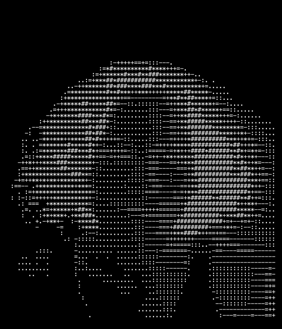

```zsh
> whoami
```
<table>
  <tr>
    <td width="40%" valign="top">
      
      <p align="right">
        <a href="https://www.linkedin.com/in/bruna-contino-developer/">LINKEDIN ↗</a>
      </p>
    </td>
    <td width="60%" valign="top">

```text
brunades@github
------------------------------------------------
ROLE       Junior Full-Stack Developer
LOCATION   Italy · OPEN TO WHAT'S NEXT
STATUS     Always under construction

CURRENT FOCUS
  Python · FastAPI · PostgreSQL

EXPLORED
  Typescript · React · Next.js · Sass
  Node.js · Express · MongoDB · SQLite

BUILDING
  Amunì — Webapp

INTERESTED IN
  Smart ideas · Meaningful projects
  Community-driven technology · Social impact

BEYOND CODE
  Bike · Music · Wild nature
------------------------------------------------
```
